<!-- Banner -->

<!-- Typing animation -->

  

  
  

  
   
  👆 <a href="https://nimrahq.github.io/NimrahQ/">Click for the full-screen interactive version</a> (heart → world → mind → code, move your mouse, click to burst)

## 🌸 About Me

I'm a **Front-End / Full-Stack Developer with 3+ years of experience** building scalable, responsive, production-ready web apps with **React.js, Next.js and TypeScript**.

- 🏢 Currently Full-Stack Developer at **Sapphire Consulting Services**
- 📊 Built dashboards and data workflows for national-scale education platforms serving **100,000+ daily users**
- 🔐 Experienced in role-based access control (RBAC), REST API integration, and state management with **Redux Toolkit** and **Context API**
- 🎨 I love turning Figma designs into pixel-perfect, performant UIs
- 🧊 Side interest: 3D on the web with **Three.js**
- 🎓 BS Computer Science, Federal Urdu University (2023)

## 💼 Experience

| Role | Company | When |
|---|---|---|
| Full-Stack Developer | Sapphire Consulting Services | Nov 2024 – Present |
| Frontend Developer | Dipixels | Mar 2023 – Oct 2024 |
| Web Developer Intern | Stratesfy Inc | Aug 2023 – Dec 2023 |

## 🛠️ Tech Stack

  

## 🚀 Featured Work

- 🏫 **NODP PIE**: React front end for a government education platform covering 300,000+ institutions
- 🏛️ **RSU Sindh**: real-time dashboards and an EMIS reporting system used across 30 districts
- 🔒 **PMIS**: prison management system with RBAC, protected routes and hierarchical permissions

## 🎨 Personal Projects

| Project | Tech | Live |
|---|---|---|
| 3D Portfolio | Three.js | [Demo](https://nimrahq.github.io/PortfolioThreeJs/) |
| Restaurant Site | React, Tailwind CSS | [Demo](https://nimrahq.github.io/restaurent/) |
| NFT Landing Page | HTML, CSS | [Demo](https://nimrahq.github.io/NFT2/) |

## 📊 GitHub Stats

  
  

  

## 🐍 Contribution Snake

  <picture>
    <source media="(prefers-color-scheme: dark)" srcset="https://raw.githubusercontent.com/NimrahQ/NimrahQ/output/github-snake-dark.svg" />
    <source media="(prefers-color-scheme: light)" srcset="https://raw.githubusercontent.com/NimrahQ/NimrahQ/output/github-snake.svg" />
    
  </picture>

## 💌 Let's Connect

  
  
  

